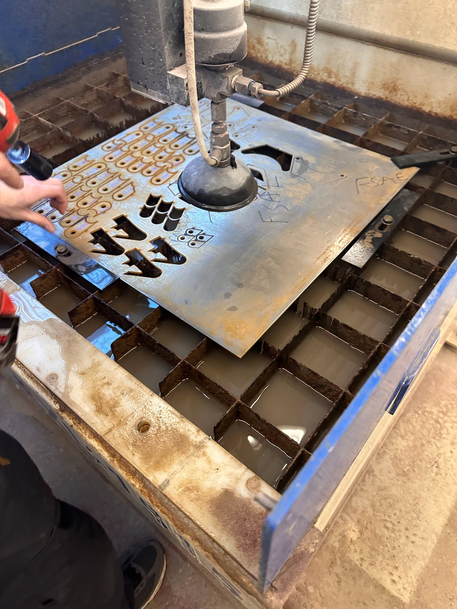
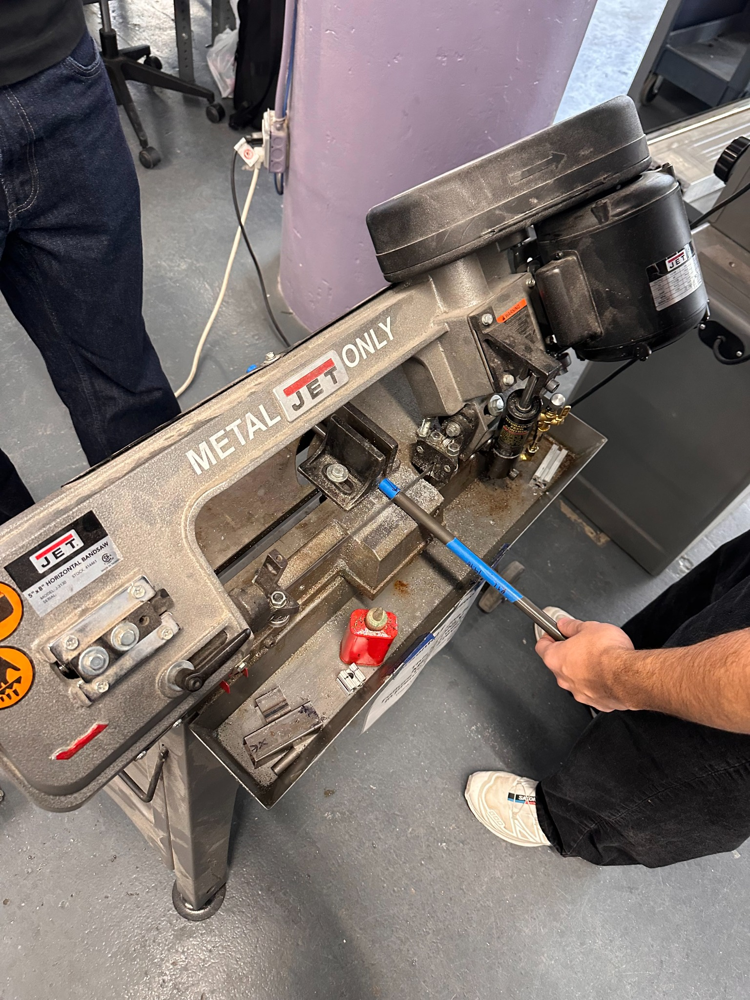

# FSAE fixtures and fabrication

Designed and revised three FDM-printed fit-up fixtures; prepared 32 waterjet-cut steel tabs and checked alignment and assembly order during chassis fit-up.

## My contribution

Constrained tube and tab geometry for cutting, fit-up and TIG tack preparation. Checked support geometry and assembly sequence against CAD before welding.

My active Motorsports role includes designing parts for machining and testing, considering manufacturing constraints, and using team-collected data and calculations to make design recommendations. This ongoing role is separate from the retained fabrication photographs and the unbuilt rocker study below.

## Shop work

The fixtures constrained tube and tab geometry during cutting, fit-up and TIG tack preparation. Tab preparation and alignment checks supported the team’s suspension and steering fabrication.

The photographs show the shop operations and tab sheet. Photographs of the printed fixtures will be added when available.

## Later rocker design study

The [engineering report](https://www.mergenulziibayar.com/downloads/reports/fsae-fixtures.pdf) connects this fabrication record with a later, unbuilt split-rocker concept and its retained 75-case computational comparison. The rocker results are assumed-load static body screens, not vehicle tests or qualification of the bearings, joints, contact or fatigue. A stopped bearing-reaction compatibility check remains unresolved; neither bearing capacity nor completed project closure is claimed. Recent CAD automation and analysis were AI-assisted under my direction and review.

## Fabrication photographs

[Full case study](https://www.mergenulziibayar.com/projects/fsae-fixtures) · [Portfolio](https://www.mergenulziibayar.com)

## Record scope

This repository publishes the existing project photographs and CAD renders. [Image sources and hashes](sources.json) preserve their provenance. CAD renders are illustrations of the design record; native CAD files are not included. No new experiment was performed for this publication.

The fixture and tab counts are transcribed from the owner’s existing resume record in `500ft/Portfolio`, commit `9ecef2596cc078366325cac99261b3b4eba1fdbb`, `resume/Mergen_Ulziibayar_Resume.tex`.
